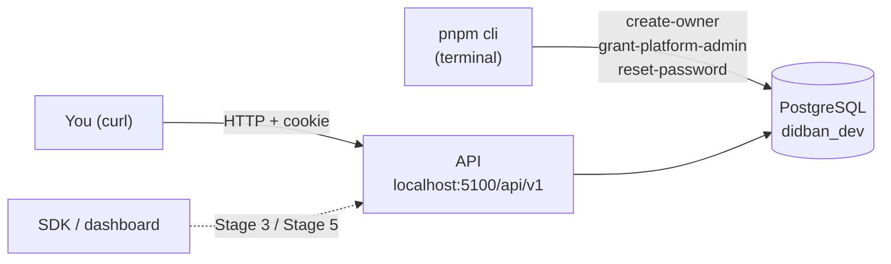
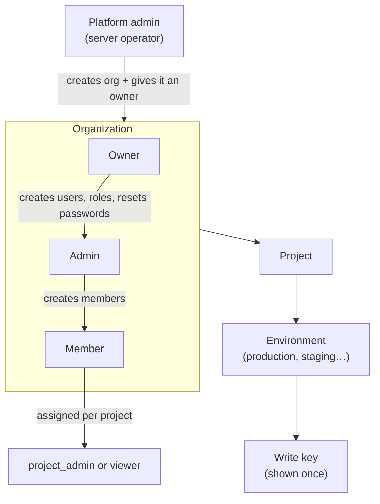
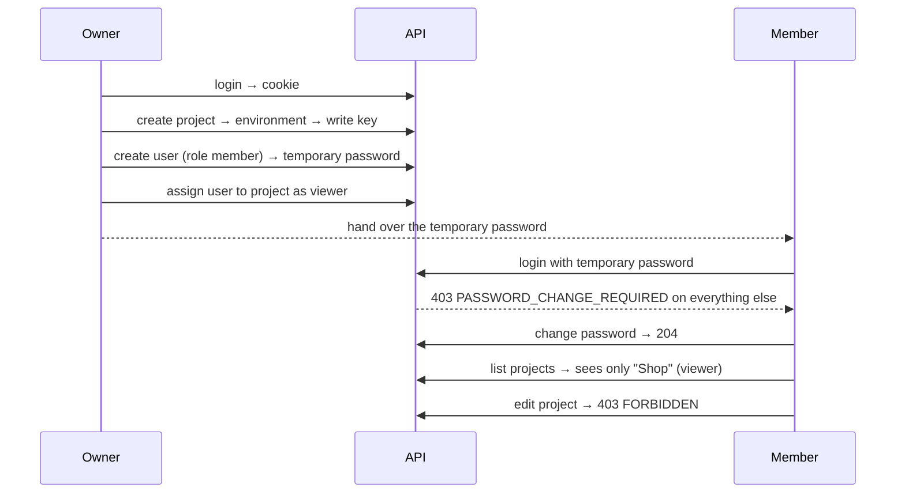

# Manual testing guide (Stage 2: accounts, access, projects)

What exists today: the **API only** (no dashboard yet, no event ingestion yet).
You test it with `curl` in Git Bash. Every step below was run against a live server on 2026-10-17.

## 1. The big picture



## 2. Who can do what



| Role | Projects | Users / roles | Audit log | Other orgs |
|---|---|---|---|---|
| owner | all, manage | yes | yes | 404 |
| admin | all, manage | members only | yes | 404 |
| member | only assigned | no | no | 404 |
| viewer (project) | read only | no | no | 404 |

## 3. Status codes you should see

| Code | Meaning |
|---|---|
| 200 / 201 / 204 | OK |
| 401 | not logged in (no or expired cookie) |
| 403 `CSRF_REJECTED` | wrong or missing `Origin` on a POST/PATCH/PUT/DELETE |
| 403 `PASSWORD_CHANGE_REQUIRED` | logged in with a temporary password; change it first |
| 403 `FORBIDDEN` | you can see it but your role cannot do this |
| 404 | does not exist **or** belongs to another org (same answer on purpose) |

## 4. Setup (once)

```bash
pnpm db:migrate
```

```bash
pnpm cli create-owner
```

Answer the prompts (email, org name, password twice). Then start the API and keep that terminal open:

```bash
pnpm -C apps/api dev
```

In a **second** terminal, set helpers (paste once per terminal):

```bash
B=http://localhost:5100/api/v1; O="Origin: http://localhost:5173"; J="Content-Type: application/json"
```

## 5. The main flow



| # | Step | Command | Expect |
|---|---|---|---|
| 1 | Login | `curl -c own.txt -H "$O" -H "$J" -d '{"email":"YOU","password":"PASS"}' $B/auth/login` | 200 |
| 2 | Who am I | `curl -b own.txt $B/auth/me` | 200 |
| 3 | My orgs (copy `id` → `ORG=...`) | `curl -b own.txt $B/organizations` | 200 |
| 4 | Create project (copy `id` → `P=...`) | `curl -b own.txt -H "$O" -H "$J" -d '{"name":"Shop","reportingTimezone":"Asia/Tehran"}' $B/organizations/$ORG/projects` | 201 |
| 5 | Create environment (→ `E=...`) | `curl -b own.txt -H "$O" -H "$J" -d '{"name":"production","allowedOrigins":["https://shop.example"]}' $B/projects/$P/environments` | 201 |
| 6 | Create write key | `curl -b own.txt -H "$O" -H "$J" -d '{"kind":"write_browser"}' $B/projects/$P/environments/$E/keys` | 201, `token` shown once |
| 7 | List keys | `curl -b own.txt $B/projects/$P/keys` | 200, no `token` |
| 8 | Create user (→ `U=userId`, note `temporaryPassword`) | `curl -b own.txt -H "$O" -H "$J" -d '{"email":"m@example.test","role":"member"}' $B/organizations/$ORG/users` | 201 |
| 9 | Make them project viewer | `curl -b own.txt -X PUT -H "$O" -H "$J" -d '{"role":"viewer"}' $B/projects/$P/members/$U` | 204 |
| 10 | Member login | `curl -c mem.txt -H "$O" -H "$J" -d '{"email":"m@example.test","password":"TEMP"}' $B/auth/login` | 200, `mustChangePassword: true` |
| 11 | Blocked until change | `curl -b mem.txt $B/projects` | 403 `PASSWORD_CHANGE_REQUIRED` |
| 12 | Change password | `curl -b mem.txt -c mem.txt -H "$O" -H "$J" -d '{"currentPassword":"TEMP","newPassword":"a-new-long-passphrase"}' $B/auth/password` | 204 |
| 13 | Member sees project | `curl -b mem.txt $B/projects` | 200, role `viewer` |
| 14 | Viewer cannot edit | `curl -b mem.txt -X PATCH -H "$O" -H "$J" -d '{"name":"X"}' $B/projects/$P` | 403 `FORBIDDEN` |
| 15 | Audit log | `curl -b own.txt $B/organizations/$ORG/audit-log` | 200, newest first |

## 6. Security checks (should all fail safely)

| Check | Command | Expect |
|---|---|---|
| No cookie | `curl $B/projects` | 401 |
| Foreign site | `curl -b own.txt -H "Origin: http://evil.test" -H "$J" -d '{"name":"x"}' $B/organizations/$ORG/projects` | 403 `CSRF_REJECTED` |
| Other org's data | log in as an owner of a **second** org (`pnpm cli create-owner` again) and call steps 4–7 and 15 with the first org's IDs | 404 every time |
| Reset kills old session | `curl -b own.txt -H "$O" -H "$J" -d '{}' $B/organizations/$ORG/members/$U/password-reset`, then `curl -b mem.txt $B/auth/me` | 200, then 401 |
| Logout | `curl -b own.txt -X POST -H "$O" -H "$J" -d '{}' $B/auth/logout`, then `curl -b own.txt $B/auth/me` | 204, then 401 |

## 7. Platform admin (server operator)

```bash
pnpm cli grant-platform-admin second-owner@example.test
```

Log in again as that user (granting revokes their sessions), then:

| Step | Command | Expect |
|---|---|---|
| New org (→ `N=organizationId`) | `curl -b adm.txt -H "$O" -H "$J" -d '{"name":"Client Co"}' $B/admin/organizations` | 201 |
| Give it an owner | `curl -b adm.txt -H "$O" -H "$J" -d '{"email":"client@example.test"}' $B/admin/organizations/$N/owners` | 201, temporary password |
| Suspend an org | `curl -b adm.txt -X PATCH -H "$O" -H "$J" -d '{"suspended":true}' $B/admin/organizations/$ORG` | 204; its owner now gets 404 |
| Unsuspend | same with `false` | 204 |

A platform admin still gets **404** on an org's data unless they are a member of it.

## 8. Automated checks (same thing, run by the machine)

```bash
pnpm lint && pnpm typecheck && pnpm test && pnpm build
```

Forgot a password? `pnpm cli reset-password <email>` prints a new temporary one.
